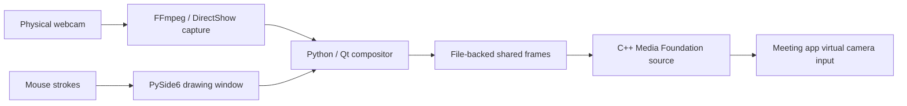

# Camera Whiteboard

### Draw your explanation. Stay on camera.

[](https://github.com/Coral-TSS/camera-whiteboard/releases/tag/v0.1.0)
[](LICENSE)

**[Download the Windows app](https://github.com/Coral-TSS/camera-whiteboard/releases/tag/v0.1.0)** · [User guide](packaging/USER_GUIDE.md) · [Contribute](CONTRIBUTING.md)

If this makes your next explanation easier, a star helps others discover it. Feedback, bug reports, and small contributions are welcome.

A lightweight **Windows 11 virtual camera whiteboard**: sketch with your mouse, place the board over your webcam video, and send both through one camera source in your meeting app.

No OBS setup. No screen sharing required. No cloud account. Just a drawing window and a virtual camera.

**Windows 11 x64 · Python / PySide6 · C++ / Media Foundation · Local processing**

> Early release: the app has automated tests and a packaged dependency check. Clean-machine installation and remote meeting acceptance for this build are still pending. See [validation notes](validation/english-release-2026-10-27.md).

## Why this exists

A quick diagram can explain what a paragraph cannot. Camera Whiteboard keeps that diagram beside your face: useful for tutoring, technical interviews, pair programming, and explaining a flow during a call.

1. Open the board and sketch.
2. Choose where it appears in the outgoing video.
3. Select **Camera Whiteboard** in your meeting app.
4. Hide the board when you are done; your camera video continues on the same device.

## What you can do

- **Draw quickly:** pen, whole-stroke eraser, five colors, three widths, undo and clear.
- **Place your board:** nine grid positions plus four rule-of-thirds positions, with adjustable size.
- **Keep working underneath:** toggle mouse click-through with a hotkey.
- **Keep one video source:** hiding the drawing window removes the board without switching cameras.
- **Send readable diagrams:** unmirrored strokes by default; optional stroke-only flip, or a board-only flip that reflects both placement and strokes without flipping the camera.
- **Run locally:** capture, composition and frame transfer happen on your PC.

The outgoing video is **1280 × 720 (16:9)**; the drawing sheet remains **4:3**. The preferred camera path requests 720p MJPEG, with a lower-resolution fallback for unsupported cameras. Actual capture rate depends on the device and lighting.

## Try the Windows app

Download **CameraWhiteboard-win11-x64-English.zip** from [Releases](https://github.com/Coral-TSS/camera-whiteboard/releases/tag/v0.1.0). Use the complete `app/` folder from the ZIP, not a single copied executable.

1. Extract the ZIP to a local folder.
2. Close Camera Whiteboard and any client using its virtual camera before installing or updating.
3. Run **Install.cmd** once and approve the administrator prompt.
4. Launch **CameraWhiteboard.exe** as your normal Windows user.
5. In your meeting app, select **Camera Whiteboard**. Windows may append **Windows Virtual Camera** to the name.

Python, Qt, OpenCV and FFmpeg are bundled. You do not need to install OBS, Python or developer tools on the destination PC. Installation registers a native software camera source; it does not change your camera privacy settings.

The board's **Menu** contains drawing tools, output placement, camera controls and calibration. The tray icon lets you show the board or quit.

| Shortcut | Action |
|---|---|
| `Ctrl + Alt + F8` | Toggle mouse click-through |
| `Ctrl + Alt + F9` | Undo |
| Close the board window | Hide the board; keep camera video running |
| Tray → Quit | Exit and release the camera |

**Left means left in the outgoing video when board mirroring is off.** A meeting app may mirror its local self-view. Disable that preview setting or check with a remote participant; flipping outgoing strokes to correct a mirrored preview makes the remote diagram backwards.

For installation, permissions and troubleshooting, read the [user guide](packaging/USER_GUIDE.md). Uninstall with **Uninstall.cmd** after quitting the app and closing camera clients.

### Board-only mirror control

Enable **Mirror board position + strokes** from the board menu or tray to reflect both the board's placement and drawing. The camera video never flips. Leave **Mirror strokes only** off for the combined effect. Both controls start off; the board switch changes the outgoing board, not just a local preview.

## How it works



Capture runs in the interactive user session. The C++ media source is loaded through Windows Camera Frame Server and reads the composed frames. The native source is based on [VCamSample](https://github.com/smourier/VCamSample), with local frame-transfer and product-identity changes.

## Build from source

Current build baseline:

- Windows 11 x64
- Python 3.13 x64
- Visual Studio Build Tools 2026 with C++ **v145** tools
- Windows SDK **10.0.26100.0**

```powershell
py -3.13 -m venv .venv
.venv\Scripts\python.exe -m pip install -r requirements-dev.txt

# Adjust VSRoot in scripts/env.cmd / scripts/env.ps1 if VS is installed elsewhere.
scripts\build-vcamsample.cmd
New-Item -ItemType Directory -Force .run | Out-Null
```

For development only, register the built DLL from an **administrator PowerShell**:

```powershell
powershell -NoProfile -ExecutionPolicy Bypass -File scripts\register_vcam.ps1
```

Then return to a normal terminal:

```powershell
.venv\Scripts\python.exe scripts\run_ui.py
```

Development registration points at the build directory. Distributions use **Install.cmd**, which copies the media source into Program Files. Do not ship a registry entry that points at your development checkout.

### Test

```powershell
$env:QT_QPA_PLATFORM = 'offscreen'
New-Item -ItemType Directory -Force .build\test-temp | Out-Null
$env:TEMP = (Resolve-Path .build\test-temp).Path
$env:TMP = $env:TEMP
.venv\Scripts\python.exe -m unittest discover -s tests\ui -p 'test_*.py'
```

Build the native DLL first: the distribution tests also check that it accepts the product CLSID. Unit tests and direct DLL checks do not prove Frame Server activation or meeting-client compatibility.

### Package

```powershell
.venv\Scripts\python.exe -m PyInstaller packaging\whiteboard.spec --noconfirm --distpath packaging\dist --workpath packaging\build
.venv\Scripts\python.exe scripts\export_release.py --output release\CameraWhiteboard-English --language en
```

Use a new output path for each export; the exporter refuses to overwrite an existing folder.

```text
CameraWhiteboard-English/
├── source/           Clean source snapshot for GitHub
├── app/              App, bundled runtimes, installer and user guide
├── README.md
└── SHA256SUMS.txt
```

Commit the contents of **source/** as the repository root. Upload the application ZIP as a **GitHub Releases** asset instead of committing large binaries. Never publish `.run/`: it may contain camera frames and local logs.

## For contributors and AI coding assistants

The fastest way to understand this repository is to follow the actual frame path, rather than the early directory plan.

| Start here | Responsibility |
|---|---|
| `ui/camera_whiteboard/app.py` | Application wiring, menus, tray and timers |
| `canvas.py` → `render.py` | Stroke model and rasterization |
| `layout.py` → `compositor.py` | Board placement and outgoing video composition |
| `camera.py` | Physical-camera backends and latest-frame storage |
| `publisher.py` | BGRA frame publication |
| `third_party/vcamsample/VCamSampleSource/` | Native camera source, frame reader and COM identity |
| `packaging/` + `scripts/export_release.py` | Windows distribution and clean source export |
| `tests/ui/` | Behavioral tests, including English UI and packaging checks |

`native/` contains planning placeholders, not the active engine. Current capture and composition live in Python. Read the [architecture notes](docs/ARCHITECTURE.md) and [contribution guide](CONTRIBUTING.md) before changing the pipeline.

Keep these contracts intact:

- Source publisher and DLL must agree on dimensions, pixel format and frame-header layout.
- Board placement uses outgoing-video coordinates, independent of stroke mirroring.
- Hiding the board must not release the camera or stop the video stream.
- Keep the media-source DLL independent of Python and Qt.
- Do not describe direct in-process tests as successful meeting-client validation.

Useful next contributions: camera disconnect recovery, consistent shared-frame snapshots, installer acceptance on a clean PC, and remote-client compatibility reports with exact versions and reproduction steps.

## Current boundaries

- Windows 11 x64 only; no macOS, Linux, ARM64, microphone or audio routing.
- One interactive user per installation; changing Windows accounts requires running the installer for that account.
- The physical camera is held while enabled. Use **Release camera** if another app needs it.
- Camera disconnect recovery is limited; restarting the app may be necessary.
- The current shared-frame reader still needs stronger consistency checks around pixel copying.
- Builds are unsigned. Clean-PC installation, sleep/resume and remote meeting acceptance remain separate validation tasks.
- Historical design and experiment notes under `specs/` and `validation/` include Chinese and may describe older behavior. This README and the current code describe the English release.

## License and credits

Original Camera Whiteboard code and the vendored VCamSample are **MIT licensed**. Bundled dependencies retain their own licenses, including Qt's open-source terms and the separate FFmpeg executable's GPL terms. See [LICENSE](LICENSE), [third-party notes](docs/third-party.md) and [distribution notices](packaging/licenses/NOTICE.md).

**Keywords:** webcam whiteboard, virtual camera, video-call drawing, desktop annotation, Windows 11, Media Foundation, PySide6, camera overlay.
